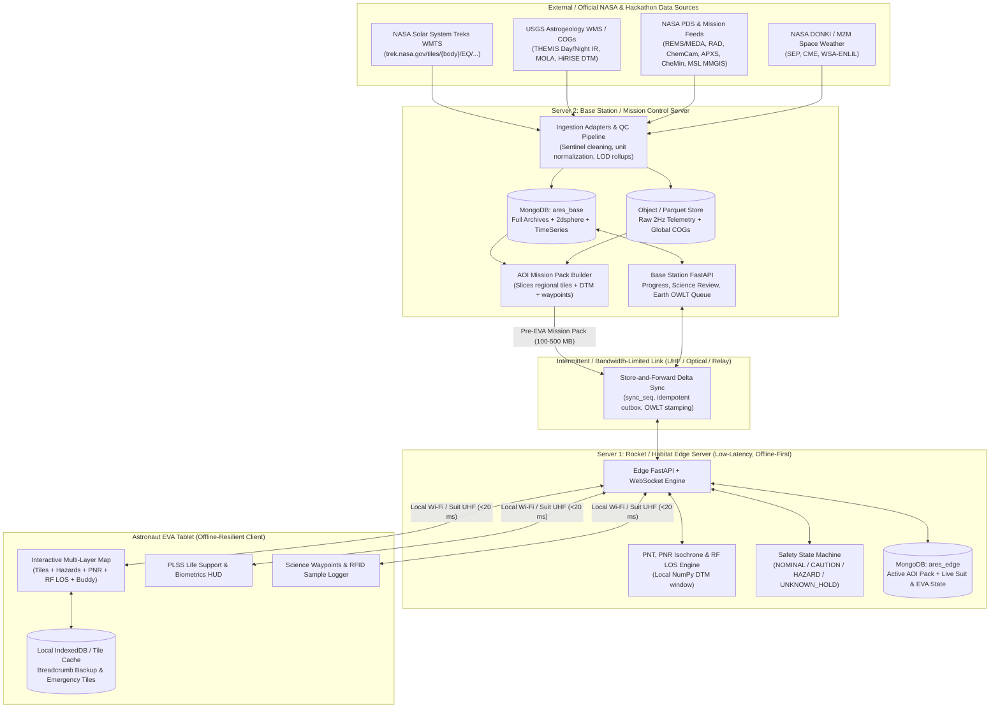
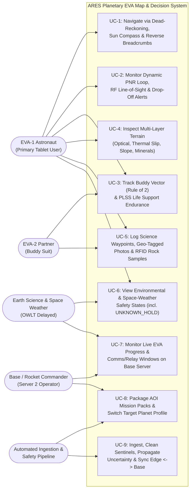

# 01 — System Architecture, Multi-Planet Extensibility & Use Cases

> **Scope:** End-to-end architecture for the **ARES Exploration Tablet**, **Edge Server (Rocket / Habitat)**, and **Base Station Server**, designed from the ground up to operate on **Mars** today and adapt dynamically to **Venus**, **Jupiter/Europa**, the **Moon**, or any future target body via data-driven `PlanetProfile` configuration.

---

## 1. Core Architectural Principle: Planet-Agnostic by Design

Nothing in the core engine hardcodes Mars constants (`R = 3,396,190 m`, `g = 3.72 m/s²`, `sol = 88,775.244 s`, `Gale Crater`, or `MRO` relays). Instead, every spatial calculation, safety threshold, clock formatter, and map tile loader reads from a active **`PlanetProfile`** document stored in MongoDB.

### How a Single Codebase Supports Mars, Venus & Jupiter Systems

| Subsystem | Mars (Current Mission) | Venus (Aerobot / Armored Probe) | Jupiter / Europa (Ice Shell / Radiation) | How It Stays Dynamic |
|---|---|---|---|---|
| **Planetary CRS & Radius** | `IAU:49900`, $R = 3,396,190\ \text{m}$ | `IAU:29900`, $R = 6,051,800\ \text{m}$ | `IAU:50200` (Europa $R = 1,560,800\ \text{m}$) / Jovian system | `planet_profiles.crs` + `radius_m` injected into PNT, tile math & `proj4` |
| **Gravity & Slope Cost** | $g = 3.72\ \text{m/s}^2$ | $g = 8.87\ \text{m/s}^2$ | $g_{\text{Europa}} = 1.315\ \text{m/s}^2$ | `planet_profiles.gravity_ms2` parameterizes metabolic & PNR traversal models |
| **Timekeeping** | Sol = `88,775.244 s` (`LMST` / `LTST`, $L_s$) | Venus sidereal/solar day or Mission UTC + cloud-superrotation clock | Orbital / Io-phase / `UTC` + Europa day (`306,822 s`) | `planet_profiles.clock_model` drives dual Earth/Target clock bar |
| **Tile Base Layers** | `trek.nasa.gov/tiles/Mars/EQ/...` + USGS WMS | Magellan SAR / Venus Trek (`trek.nasa.gov/tiles/Venus/...`) | Galileo / Juno / Clipper (`trek.nasa.gov/tiles/Europa/...`) | `source_register` + `map_layers` templates parameterized by `{body}` |
| **Primary Hazards** | Hypobaric vacuum, dust storms, GCR/SEP radiation, cold, slopes | Extreme pressure (`~92 bar` surface), `~460 °C` heat, $\text{H}_2\text{SO}_4$ acid clouds | Intense trapped magnetospheric radiation, cryogenic ice crevasses | `planet_profiles.safety_thresholds` evaluates arbitrary `{metric_key, warn, critical}` rules |
| **Comms & OWLT** | OWLT `3–22 min`; MRO / Odyssey / MAVEN relays | Direct-to-orbiter / Venus relay; OWLT `2–14 min` | OWLT `33–53 min`; Jovian relay blackout windows | `comms_windows` + `owlt_model` compute link budget & message age |

---

## 2. Two-Server + Tablet System Architecture

To guarantee **millisecond responsiveness** for life-critical EVA alerts while keeping **full planet-scale archives** accessible for mission planning, compute and storage are split across three tiers:

### Why This Split Matters
1. **Server 1 (Rocket / Habitat Edge)** runs **100% offline** during an EVA. It holds only the pre-staged **AOI Mission Pack** (local DTM, CTX/HiRISE tiles, THEMIS slip layer, nearby science waypoints, and active weather/radiation baselines), ensuring **PNR boundaries, drop-off alarms, and RF LOS checks never wait on Earth or Base Station**.
2. **Server 2 (Base Station)** handles heavy **whole-planet ingestion**, raw multi-sol archives (Parquet + MongoDB), **Base Commander progress monitoring**, science sample cataloguing, and Earth Mission Control message queues (with explicit **OWLT** tags).
3. **Tablet** caches current viewport tiles and breadcrumbs locally in IndexedDB so even a temporary disconnect from the Rocket/Habitat link leaves reverse-breadcrumb navigation intact.

---

## 3. Handling Whole-Planet Scale Without Crashing the Tablet

- **Multi-Resolution Raster Pyramids:** Global coverage (`MOLA 463 m/px`, `THEMIS 100 m/px`) takes only a few thousand `256×256` tiles. High-res `CTX` (`~5 m/px`) and `HiRISE` (`0.25–1 m/px`) are streamed strictly for the visible `bbox` or pre-packed into the active EVA AOI (`~10 km × 10 km`).
- **Spatial Viewport Queries (`2dsphere` + `bbox`):** Dense vectors (`1,053` THEMIS stamps, `1,388` MSL waypoints, ChemCam targets, boulder hazards) are never sent all at once; the backend clips to the active viewport and clusters at low zoom.
- **Telemetry LOD Rollups:** Raw `2 Hz` telemetry (`103,011` rows/sol in `mars_site_complete_telemetry.csv`) stays in Server 2 archives/Time-Series; the tablet consumes **15-min diurnal rollups** (`63` records/sol) or **1-sol seasonal summaries**, drilling into raw slices only on demand.
- **Resolution-Aware Unknown States:** Whenever the astronaut pans outside `1 m` DTM coverage onto `463 m` MOLA, the safety engine downgrades `Drop-Off` and `Boulder Clearance` to `UNKNOWN_LOW_RES (CAUTION)` rather than falsely reporting flat terrain.

---

## 4. Use Case Diagram

### Key Actor Flows
- **UC-1 / UC-2 / UC-3 (EVA Survival Loop):** EVA-1 moves across Mount Sharp; Server 1 updates dead-reckoning position + $1\sigma$ ellipse, checks Sun-azimuth heading, updates EVA-2 buddy vector, recomputes the slope/slip-weighted **PNR isochrone** from PLSS remaining endurance, verifies UHF **RF LOS** to habitat, and fires immediate **Drop-Off** or **`UNKNOWN_HOLD`** banners if approaching a cliff or losing a critical sensor.
- **UC-4 / UC-5 (Boxwork Science Loop):** At a boxwork ridge waypoint, EVA-1 inspects `ChemCam`/`APXS`/`CheMin` prior evidence + `CRISM` mineral layer, captures a geo-tagged photo, tags a sample bag via **RFID**, and logs it locally; Server 1 syncs it to Server 2 when UHF/relay is available.
- **UC-7 / UC-8 (Base & Multi-Planet Ops):** Base Commander monitors EVA progress, relay countdowns (`MRO`), and Earth `OWLT` messages on Server 2, or switches `PlanetProfile` from `mars` to `venus` / `europa` to deploy an AOI Mission Pack for a different mission.
