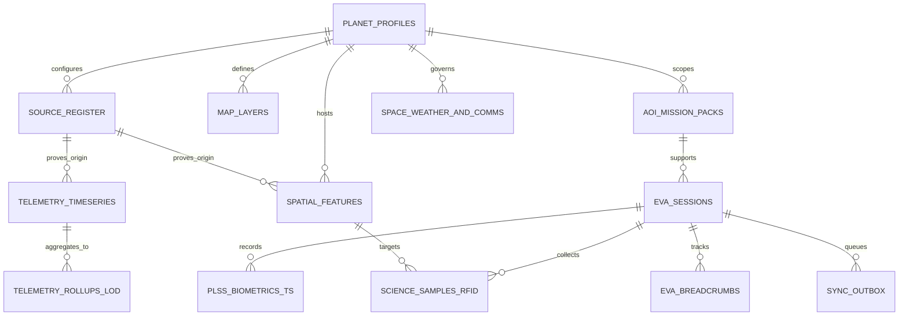

# 04 — MongoDB Database Layout (Multi-Planet & Two-Server Sync)

> **Scope:** Complete MongoDB schema design for **`ares_base`** (Server 2: full planetary archives & mission control) and **`ares_edge`** (Server 1: low-latency offline AOI cache & live EVA state). Every collection is partitioned by `body` (`"mars"`, `"venus"`, `"europa"`, `"jupiter"`, etc.) and `mission_id` so new planets require only inserting configuration documents.

---

## 1. Database Topology & Entity Relationship Diagram

- **Server 2 (`ares_base`):** Stores global/regional `planet_profiles`, `source_register`, `map_layers`, `spatial_features` (`2dsphere`), `telemetry_timeseries`, `telemetry_rollups_lod`, `aoi_mission_packs`, `space_weather_events`, and synced EVA logs.
- **Server 1 (`ares_edge`):** Mirrors only the active `planet_profiles`, `source_register`, active `aoi_mission_packs` spatial slice, recent `telemetry_rollups_lod`, live `plss_biometrics_ts`, `eva_sessions`, `science_samples_rfid`, and a `sync_outbox` queue.



---

## 2. Core Collections & Document Schemas

### 2.1 `planet_profiles` (Dynamic Multi-Planet Brain)
Drives CRS, gravity, clocks, atmospheric/radiation thresholds, and Trek/WMS body identifiers.

```json
{
  "_id": "mars",
  "display_name": "Mars",
  "trek_body_id": "Mars",
  "crs": {
    "code": "IAU:49900",
    "proj4": "+proj=longlat +a=3396190 +b=3396190 +no_defs",
    "semi_major_m": 3396190.0,
    "semi_minor_m": 3396190.0
  },
  "physics": {
    "gravity_ms2": 3.72076,
    "solar_day_seconds": 88775.244,
    "has_global_magnetic_field": false,
    "owlt_range_sec": [180, 1340]
  },
  "clock_model": {
    "day_unit_label": "SOL",
    "local_time_label": "LMST",
    "seasonal_metric": "ls_deg"
  },
  "safety_thresholds": {
    "wind_speed_ms": {"caution": 15.0, "hazard": 28.0},
    "radiation_dose_msv_day": {"caution": 1.5, "hazard": 10.0},
    "slope_deg": {"caution": 20.0, "hazard": 30.0},
    "max_staleness_sec": {"wind": 120, "radiation": 300, "plss": 10}
  }
}
```

#### Zero-Code-Change Extension Examples (Venus & Jupiter / Europa)
```json
// Example: Venus Aerobot / Armored Surface Mission
{
  "_id": "venus",
  "display_name": "Venus",
  "trek_body_id": "Venus",
  "crs": {"code": "IAU:29900", "proj4": "+proj=longlat +a=6051800 +b=6051800 +no_defs", "semi_major_m": 6051800.0},
  "physics": {"gravity_ms2": 8.87, "solar_day_seconds": 10087200.0, "has_global_magnetic_field": false, "owlt_range_sec": [130, 860]},
  "clock_model": {"day_unit_label": "VENUS_DAY", "local_time_label": "VLT", "seasonal_metric": "orbit_phase_deg"},
  "safety_thresholds": {
    "pressure_pa": {"caution": 5000000.0, "hazard": 9000000.0},
    "ambient_temp_c": {"caution": 350.0, "hazard": 450.0},
    "h2so4_aerosol_ppm": {"caution": 5.0, "hazard": 20.0}
  }
}
```
```json
// Example: Europa (Jovian System) Ice-Surface / Sub-Orbital Mission
{
  "_id": "europa",
  "display_name": "Europa (Jupiter II)",
  "trek_body_id": "Europa",
  "crs": {"code": "IAU:50200", "proj4": "+proj=longlat +a=1560800 +b=1560800 +no_defs", "semi_major_m": 1560800.0},
  "physics": {"gravity_ms2": 1.315, "solar_day_seconds": 306822.0, "has_global_magnetic_field": false, "owlt_range_sec": [1980, 3180]},
  "clock_model": {"day_unit_label": "EUROPA_ROT", "local_time_label": "ELT", "seasonal_metric": "jovian_phase_deg"},
  "safety_thresholds": {
    "radiation_dose_msv_day": {"caution": 500.0, "hazard": 5000.0},
    "ice_crevasse_slope_deg": {"caution": 15.0, "hazard": 25.0}
  }
}
```

---

### 2.2 `source_register`
Stores provenance, canonical units, temporal cadence, and spatial resolution caveats per dataset.

- **Indexes:** `{ body: 1, source_id: 1 }` (unique)
```json
{
  "source_id": "msl_chemcam_moc",
  "body": "mars",
  "instrument": "ChemCam LIBS",
  "pds_bundle": "MSL-M-CHEMCAM-LIBS-4/5-RDR-V1.0",
  "source_type": "nasa_pds",
  "canonical_units": {"oxides": "wt%", "distance": "m"},
  "timebases": ["SCLK", "SOL", "LMST"],
  "spatial_limitation": {
    "footprint_m": 0.0005,
    "range_m": 7.0,
    "note": "Microscopic 300-600 um laser spot; never extrapolate a single shot to an entire outcrop."
  }
}
```

---

### 2.3 `map_layers`
Registers WMTS, WMS, COG, or pre-computed hazard tile layers per `body`.

- **Indexes:** `{ body: 1, layer_id: 1 }` (unique)
```json
{
  "layer_id": "gale_ctx_optical",
  "body": "mars",
  "category": "optical",
  "protocol": "WMTS_EQ",
  "url_template": "https://trek.nasa.gov/tiles/{body}/EQ/Gale_CTX_BlockAdj_dd/1.0.0/default/default028mm/{z}/{y}/{x}.png",
  "tile_size_px": 256,
  "zoom_range": [0, 12],
  "resolution_m": 5.5,
  "bbox": [135.1842593, -6.5732988, 139.2413012, -2.8077809],
  "supports_dropoff_alerts": false
}
```

---

### 2.4 `spatial_features` (`2dsphere` GeoJSON Collection)
Unified vector collection for **Science Waypoints** (`ChemCam`/`APXS`/`CheMin`/`CRISM`), **Historical Rover Traverses** (`MSL_waypoints`/`MSL_traverse`), **THEMIS Stamps** (`Gale Crater.csv`), **Hazard Polygons** (boulders/cliffs/slip traps), and **Landmarks**.

- **Indexes:**
  - `{ geometry: "2dsphere" }` *(fast viewport `bbox` & radius queries)*
  - `{ body: 1, feature_type: 1, priority: 1 }`
  - `{ body: 1, "properties.sol": 1 }`
```json
{
  "feature_id": "wp_mount_sharp_boxwork_01",
  "body": "mars",
  "mission_id": "ares_gale_boxwork_01",
  "feature_type": "science_waypoint",
  "geometry": {
    "type": "Point",
    "coordinates": [137.3891532, -4.82567778]
  },
  "elevation_m": -3473.684,
  "position_uncertainty_m": 2.5,
  "priority": "HIGH",
  "properties": {
    "name": "Mount Sharp Boxwork Ridge A",
    "geologic_unit": "Sulfate-bearing boxwork unit",
    "hypothesis": "Fracture-fill mineral veins cemented during late groundwater episodes",
    "supporting_evidence": [
      {
        "source_id": "msl_apxs",
        "target": "Boxwork_Vein_Ref",
        "metrics": {"SO3_wt_pct": 28.4, "CaO_wt_pct": 19.1, "uncertainty_1sigma": 0.6},
        "footprint_m": 0.017
      }
    ],
    "eva_task": "Capture stereo close-up, test ridge vs. hollow hardness, bag 2x RFID samples",
    "pov_image_uri": "/assets/pov/msl_sol5070_boxwork.jpg"
  },
  "provenance": {"source_id": "msl_mmgis_waypoints", "rmc": "125_2274", "sol": 5070}
}
```

---

### 2.5 `telemetry_timeseries` (MongoDB Time-Series Collection)
Created with `timeseries: { timeField: "ts_utc", metaField: "meta", granularity: "seconds" }` on Server 2 for high-frequency atmospheric/radiation records (`REMS`, `MEDA`, `RAD`).

- **Indexes:** `{ "meta.body": 1, "meta.station_id": 1, ts_utc: -1 }`
- **Envelope rule:** Missing values and sentinel `0.0`s from raw files are stored as `null` with explicit `status: "UNKNOWN"` and `uncertainty_type: "unreported"`.
```json
{
  "ts_utc": "2021-06-01T12:00:00Z",
  "meta": {"body": "mars", "station_id": "jezero_meda_sol100", "source_id": "meda_sample_csv"},
  "clocks": {"sclk": 675816036.0, "lmst": "00100M12:00:00", "ltst": "0100 11:57:23"},
  "metrics": {
    "air_temp_c": {"value": -34.65, "uncertainty": null, "uncertainty_type": "unreported", "status": "OK"},
    "ground_ir_temp_c": {"value": -5.94, "uncertainty": 0.60, "uncertainty_type": "calibrated_instrument", "status": "OK"},
    "wind_speed_ms": {"value": 4.62, "uncertainty": null, "uncertainty_type": "unreported", "status": "OK"},
    "gcr_dose_msv_day": {"value": null, "uncertainty": null, "status": "UNKNOWN"}
  },
  "safety_state": "CAUTION"
}
```

---

### 2.6 `telemetry_rollups_lod`
Pre-computed `15m` / `1sol` diurnal and seasonal summaries served to Server 1 and the Tablet so the UI never scans millions of raw rows.

- **Indexes:** `{ body: 1, station_id: 1, lod: 1, bucket_key: 1 }` (unique)
- Stores `min`, `max`, `mean`, `valid_fraction`, `safety_state`, and `quality_and_unknown_flags[]` (matching the structure already generated in `sample_data/telemetry_15min_sol100.json`).

---

### 2.7 `plss_biometrics_ts` (MongoDB Time-Series Collection on Server 1 → Synced to Server 2)
Created with `timeseries: { timeField: "ts_utc", metaField: "meta", granularity: "seconds" }` (`expireAfterSeconds` retention configurable).

- **Meta:** `{ body, mission_id, eva_id, suit_id }`
- **Fields:** `o2_primary_pct`, `o2_pressure_kpa`, `o2_flow_kg_h`, `o2_reserve_pct`, `ppco2_mmhg`, `scrubber_sat_pct`, `battery_kwh`, `battery_pct`, `cooling_water_l`, `heart_rate_bpm`, `resp_rate_bpm`, `metabolic_w`, `limiting_subsystem`, `remaining_endurance_min`.

---

### 2.8 `eva_sessions` & `eva_breadcrumbs`
- **`eva_sessions`:** `{ eva_id, body, mission_id, aoi_pack_id, habitat_pose, active_astronauts: ["EVA-1", "EVA-2"], status: "ACTIVE" | "COMPLETED", started_utc }`
- **`eva_breadcrumbs`:** `{ eva_id, suit_id, seq, ts_utc, geometry: { type: "Point", coordinates: [lon, lat] }, local_enu_m: [e, n, u], sigma_1_m, sun_heading_deg, buddy_distance_m, buddy_bearing_deg, pnr_margin_min, rf_los_clear, active_alerts[] }`
  - **Indexes:** `{ eva_id: 1, suit_id: 1, seq: 1 }`, `{ geometry: "2dsphere" }`

---

### 2.9 `science_samples_rfid`
Logs physical samples collected by astronauts (linked to target waypoints & geo-tagged photos).

- **Indexes:** `{ rfid_tag: 1 }` (unique), `{ mission_id: 1, sync_status: 1 }`
- **Fields:** `sample_id`, `rfid_tag`, `body`, `mission_id`, `eva_id`, `waypoint_id`, `geometry` (`2dsphere`), `sigma_1_m`, `clocks`, `photo_uri`, `field_notes`, `sync_status` (`"PENDING_SYNC" | "SYNCED_BASE"`).

---

### 2.10 `space_weather_and_comms`
Stores DONKI CME/SEP events, simulated storms, orbital relay pass schedules (`MRO`, `Odyssey`, or future Venus/Jovian orbiters), and Earth-to-Base messages with `owlt_sec` provenance.

- **Indexes:** `{ body: 1, event_type: 1, valid_from_utc: -1 }`
- **Fields:** `event_id`, `body`, `event_type` (`"SEP_ALERT" | "RELAY_PASS" | "MCC_MESSAGE"`), `origin` (`"EARTH_MCC" | "LOCAL_BASE" | "DONKI"`), `issued_utc`, `owlt_sec`, `effective_arrival_utc`, `severity`, `payload`.

---

### 2.11 `aoi_mission_packs` & `sync_outbox`
- **`aoi_mission_packs`:** `{ pack_id, body, mission_id, bbox, max_zoom, dtm_resolution_m, tile_count, size_mb, created_utc, checksum }` — tracks offline bundles staged on Server 1.
- **`sync_outbox` (Server 1 only):** `{ sync_seq, collection, op, doc_id, payload, created_utc, acked: false }` — guarantees zero data loss across UHF/relay dropouts using idempotent `sync_seq` pushes to Server 2.
