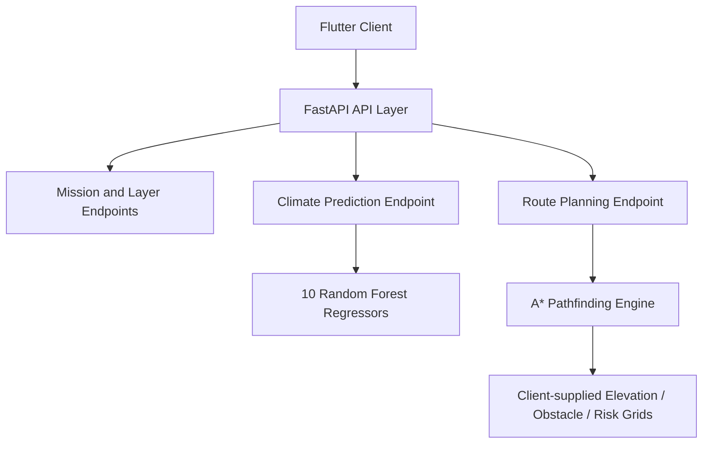

# ARES — API Layer and Backend Integration

**Project:** Astronaut Route & Exploration System (ARES)  
**Backend:** FastAPI (Python)  
**API version:** `v1`  
**Application version:** `0.2.0`  
**Development URL:** `http://127.0.0.1:8006`  
**Swagger UI:** `http://127.0.0.1:8006/docs`  
**OpenAPI schema:** `http://127.0.0.1:8006/openapi.json`

> **Architecture note:** The current MVP has a FastAPI API entry point, **not** a separately deployed API gateway (such as Kong, NGINX Gateway, or AWS API Gateway). This document describes the existing backend interface and its integration contract.

## Architecture



The API validates requests, invokes backend services, and returns JSON responses. **No authentication has been implemented in this MVP.**

## Endpoint reference

> See [06 — Handoff & API Gateway Guide](06_HANDOFF_AND_API_GATEWAY_GUIDE.md) for MongoDB/Supabase integration details, Space EDAC, and gateway proxy patterns.

| Method | Path | Purpose |
|---|---|---|
| `GET` | `/api/v1/health` | Service health check |
| `GET` | `/api/v1/mission` | Mission metadata & DB connection status |
| `GET` | `/api/v1/layers` | Map-layer status |
| `POST` | `/api/v1/climate/predict` | Experimental Mars climate predictions *(requires `artifacts/mars_models.skops`)* |
| `POST` | `/api/v1/routes/plan` | Terrain-aware A* route calculation (client-supplied grid) |
| `POST` | `/api/v1/routes/mount-sharp` | A* slope-aware routing on Mount Sharp DEM *(requires `.npy` terrain files)* |
| `POST` | `/api/v1/routes/eva-local` | Hyperlocal 500 m × 500 m EVA routing *(requires `mount_sharp_map.tif` + `rasterio`)* |
| `GET` | `/api/v1/map/planet` | Active planet profile (`ares_base.planet_profiles`) |
| `GET` | `/api/v1/map/layers` | Map layer definitions (`ares_base.map_layers`) |
| `GET` | `/api/v1/map/features` | GeoJSON spatial features (`ares_base.spatial_features`) |
| `GET` | `/api/v1/map/images` | Nearby rover photo metadata (`ares_base.raw_images`) |
| `GET` | `/api/v1/map/telemetry` | Environmental telemetry rollups (`ares_base.telemetry_rollups_lod`) |
| `GET` | `/api/v1/map/terrain-grid` | IDW elevation & slope grid for 2D/3D chunks |
| `POST` / `DELETE` | `/api/v1/map/waypoints` | Create or delete planned EVA waypoints in MongoDB |
| `POST` | `/api/v1/map/edac/test` | Hamming(7,4) + CRC32 Space EDAC simulation |
| `GET` | `/api/v1/map/streetview` | 360° Street View rover photo bundle |
| `GET` | `/api/v1/map/image-proxy` | Same-origin proxy for NASA Mars 2020 raw imagery |
| `GET` | `/api/v1/map/globe-texture` | Stitched 3D Mars globe texture (Viking / MOLA) |
| `GET` | `/api/v1/map/regional-texture` | Stitched regional CTX/HiRISE/Viking texture for 3D chunks |

### `GET /api/v1/health`

Example response:

```json
{"status":"ok","service":"ARES"}
```

### `GET /api/v1/mission`

Example response:

```json
{
  "name": "ARES",
  "study_region": "Mount Sharp, Gale Crater",
  "status": "preparation",
  "data_status": "awaiting_validation"
}
```

### `GET /api/v1/layers`

Reports the status of the `optical`, `topography`, `science`, and `environment` layers. In the current implementation, these are marked `pending`; the endpoint does **not** serve NASA map tiles or raster files.

### `POST /api/v1/climate/predict`

**Request:**

```json
{
  "latitude": -4.725,
  "longitude": 137.385,
  "ltst_time": "13:30",
  "elevation_m": -4150
}
```

**Request constraints:**

| Field | Type | Constraint |
|---|---|---|
| `latitude` | number | -90 to 90 |
| `longitude` | number | -180 to 360 |
| `ltst_time` | string | `HH:MM` local true solar time format |
| `elevation_m` | number | -10000 to 30000 |

**Response structure:**

- `inputs`: accepted input parameters.
- `predictions`: ground and air temperatures, wind speed and direction, pressure, suit pressure difference, solar geometry, sunlight percentage, UV irradiance, and solar radiation.
- `safety_alerts`: illustrative flags for extreme cold, high wind/dust, shadowed regions, and elevated UV.
- `model_metadata`: model type/count, inference method, and validation disclaimer.

The service loads **10 Random Forest regressors** from a locally available `.skops` model artifact. Its inference uses a reference location with heuristic adjustments for requested conditions. **Predictions and alerts are experimental and are not validated for astronaut EVA safety.**

**Example request:**

```bash
curl -X POST 'http://127.0.0.1:8006/api/v1/climate/predict' \
  -H 'Content-Type: application/json' \
  -d '{"latitude":-4.725,"longitude":137.385,"ltst_time":"13:30","elevation_m":-4150}'
```

### `POST /api/v1/routes/plan`

Calculates a route on a **client-supplied grid**. The backend does not yet load Mount Sharp NASA DEM data automatically.

**Example request:**

```json
{
  "start": {"x": 0, "y": 0},
  "goal": {"x": 4, "y": 4},
  "elevation": [
    [0, 0, 0, 0, 0],
    [0, 0, 0, 0, 0],
    [0, 0, 0, 0, 0],
    [0, 0, 0, 0, 0],
    [0, 0, 0, 0, 0]
  ],
  "obstacles": [
    [false, false, false, false, false],
    [false, false, true, false, false],
    [false, false, true, false, false],
    [false, false, true, false, false],
    [false, false, false, false, false]
  ],
  "cell_size_m": 10,
  "max_slope_deg": 30,
  "slope_weight": 2,
  "risk_weight": 5
}
```

**Request contract:**

| Field | Required | Notes |
|---|---|---|
| `start`, `goal` | Yes | Grid coordinates: `x` = column, `y` = row; nonnegative integers; must differ |
| `elevation` | Yes | Rectangular 2D numeric array, elevation in meters |
| `obstacles` | No | Matching 2D boolean array; `true` means blocked |
| `risk` | No | Matching 2D numeric array, values 0–1 |
| `cell_size_m` | No | Positive square-cell resolution; default `10` |
| `max_slope_deg` | No | Maximum allowed slope; default `30` |
| `slope_weight` | No | Slope cost weight; default `2` |
| `risk_weight` | No | Risk cost weight; default `5` |

Maximum supported grid size: **250,000 cells**. Both endpoints must be within bounds and unblocked. Invalid requests are rejected by schema validation.

**Example successful response** (from a previously tested 5 × 5 obstacle-wall scenario):

```json
{
  "status": "success",
  "route": [
    {"x": 0, "y": 0},
    {"x": 1, "y": 0},
    {"x": 2, "y": 0},
    {"x": 3, "y": 0},
    {"x": 3, "y": 1},
    {"x": 3, "y": 2},
    {"x": 3, "y": 3},
    {"x": 4, "y": 4}
  ],
  "distance_m": 74.142,
  "elevation_gain_m": 0.0,
  "total_cost": 74.142,
  "explored_nodes": 20,
  "terrain_source": "client_supplied_grid",
  "validated_for_eva_safety": false
}
```

**Response fields:**

| Field | Meaning |
|---|---|
| `status` | `success` or `no_route` |
| `route` | Ordered list of `{x, y}` grid positions |
| `distance_m` | Route distance in meters, or `null` if no route |
| `elevation_gain_m` | Cumulative uphill elevation gain, or `null` |
| `total_cost` | Weighted pathfinding cost, or `null` |
| `explored_nodes` | Number of explored nodes |
| `terrain_source` | `client_supplied_grid` |
| `validated_for_eva_safety` | Always `false` in the MVP |

**No-route behavior:** The endpoint may return HTTP `200` with `"status":"no_route"`, an empty route, and null metrics. Clients must inspect `status`, not only the HTTP code.

**A* implementation characteristics:** Eight-directional movement, Euclidean heuristic, obstacle avoidance, prevention of diagonal corner-cutting, slope limits, and optional risk-weighted routing.

### Integrated Theta\*, Pre-EVA Safety Dashboard, Jezero Maps & Climate History

- **`POST /api/v1/routes/plan`** now supports `algorithm: "astar" | "theta_star"` (any-angle Theta\*) plus optional pre-EVA safety parameters (`eva_budget_m`, `plss_o2_pct`, `min_reserve_pct`, `env_condition`) and returns a `safety` object from `validate_route_safety` (`safety_status`: `VALIDATED_WITHIN_MODEL` / `NOT_VERIFIED` / `UNSAFE`, `checks` for `route`, `obstacles`, `distance`, `eva_budget`, `return_to_base`, `slope`, `environment`, and `failures`).
- **`POST /api/v1/routes/eva-local`** supports `algorithm: "astar" | "theta_star"` and `site: "mount_sharp" | "jezero"`.
- **`GET /api/v1/maps/jezero/metadata`** & **`GET /api/v1/maps/jezero/tile`** serve Jezero Crater metadata and PNG tile imagery.
- **`GET /api/v1/map/climate`** queries multi-sol NASA Curiosity REMS weather history (`days=7..5000` or `start_date`/`end_date`, 1-hour cached).
- **`GET /api/v1/map/features`** supports `limit` up to `5000` and includes `mission_id` in GeoJSON feature properties.

## Errors and client handling

| HTTP status | Meaning |
|---|---|
| `200` | Successfully processed, including a possible `no_route` result |
| `422` | Request validation failure |
| `503` | Climate model unavailable or a handled climate inference failure |
| `500` | Unexpected server failure |

For `422`, FastAPI returns structured validation details. Client applications should display a useful error rather than assume every response contains a valid route.

## Run locally

From the ARES repository root:

```bash
cd backend
source .venv-climate/bin/activate
python -m uvicorn app.main:app --host 127.0.0.1 --port 8006
```

In another terminal:

```bash
curl http://127.0.0.1:8006/api/v1/health
```

Run tests:

```bash
cd backend
source .venv-climate/bin/activate
python -m pytest -q
```

**Last reported test result:** 15 passed, zero warnings.

### Climate artifact availability

The trained `.skops` model file is intentionally excluded from Git because of its size. The climate endpoint requires that artifact to be present at the backend's configured local artifact path. Coordinate its secure distribution separately; do not commit the original untrusted pickle.

## Flutter integration notes

- During local development, `127.0.0.1` refers to the **device running the client**. A physical phone must use a reachable backend address, and the server must bind to an appropriate network interface.
- Grid coordinates are **not** latitude/longitude. The geospatial data pipeline must provide an affine transform / coordinate mapping before a route can be correctly drawn on a georeferenced image.
- Use the actual processed raster resolution for `cell_size_m`; do not leave the default `10` when working with a coarser Mars DEM.
- Check `status` before drawing a route; show a no-route state when appropriate.
- Treat climate and route-safety indicators as **experimental**, not certified EVA guidance.
- `/api/v1/layers` currently reports metadata only; map imagery and tiles require separate frontend/geospatial integration.

## MVP limitations and future work

1. **Real NASA terrain ingestion pending:** The existing route endpoint uses client-supplied grids. Mount Sharp DEM ingestion, geospatial coordinate conversion, and aligned image overlays remain to be integrated.
2. **Raster resolution matters:** The downloaded MOLA/HRSC product is approximately 200 m per pixel, appropriate for regional demonstration but not rock-scale obstacle detection or astronaut foot navigation.
3. **Climate uncertainty:** Reference-location inference with heuristic adjustments is not scientifically validated for EVA decisions.
4. **Security:** No authentication, dedicated gateway, rate limiting, or public HTTPS termination has been implemented as part of this MVP.
5. **Deployment:** Local API testing does not imply a publicly deployed backend.

## Repository guidance

Keep this document at `docs/API_GATEWAY.md`. For the authoritative request/response schema from the actual checked-out source, run the backend and inspect `/docs` or `/openapi.json`. If implementation changes, update this document and the corresponding API tests together.
